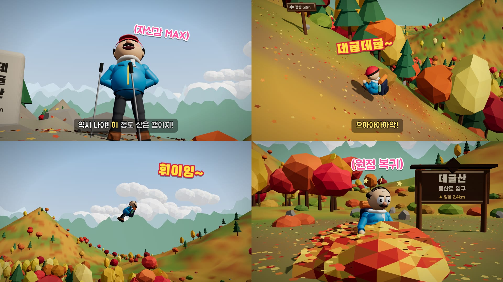

# 초고속 하산 ~ 데굴산 등반기 ~

등산복 풀장착 아저씨가 정상에서 인증샷을 찍으려다 솔방울을 밟고 **산 아래 등산로 입구까지 데굴데굴 굴러 내려가는** 62초짜리 3D 코미디 애니메이션입니다. 한국어 대사(음성)와 자막이 함께 들어 있습니다.



- 결과물: [`renders/hiker-tumble.mp4`](renders/hiker-tumble.mp4) (1920×1080, 30fps, 62초, H.264/AAC, 자막 번인 + 음성/효과음/음악)
- 자막 파일: `subtitles/hiker-tumble.ko.srt` (유튜브 업로드용 별도 자막)

## 줄거리 (13개 컷)

| 시간 | 장면 | 대사 / 예능 자막 |
| --- | --- | --- |
| 0–5.6s | 단풍 든 데굴산 전경 + 타이틀 | (내레이션) 단풍이 곱게 물든 가을 산. 오늘도 한 남자가 정상에 도전한다. |
| 5.6–11.2s | 헉헉대며 급경사를 오름 | 헉… 헉… 정상이 바로 코앞이다! / *(체력 3% 남음)* |
| 11.2–17.8s | 정상 도착, 허리에 손 얹고 자랑 | 역시 나야! 이 정도 산은 껌이지! / *(자신감 MAX)* |
| 17.8–21.4s | 셀카 화면(폰 카메라 UI) | 조금만 뒤로… 조금만 더… |
| 21.4–23s | 등산화 클로즈업 | *(솔방울 발견 못함)* |
| 23–26.8s | 미끄러짐 → 정지 화면(흑백) | 어? 어, 어어어어?! / *(하산 시작)* |
| 26.8–41.2s | 데굴데굴, 쿵!, 다람쥐에게 모자 뺏김, 공중 비행, 낙엽 더미에 푹! | 으아아아아악! / 내 등산복! 이거 비싼 거란 말이야! / *(모자 득템)* |
| 41.2–49.6s | 낙엽 더미에서 튀어나와 어질어질 | …어? 여기… 아까 출발한 곳이잖아? / *(원점 복귀)* |
| 49.6–55s | 하늘에서 떨어진 폰에 딱! → 등산 앱 "개인 최고 기록" | 오… 하산 신기록이다! |
| 55–62s | 모자 쓴 다람쥐, 산 전경, 엔딩 문구 | (내레이션) 그렇게 그는, 가장 빨리 하산한 등산객이 되었다. / *(진정한 승자)* |

## 사용한 도구 (스킬 · 플러그인 · 오픈소스)

| 역할 | 도구 |
| --- | --- |
| 영상 제작 프레임워크 | **Claude Code Remotion 스킬/플러그인** (`remotion-best-practices`, `remotion-create`, 3D·자막·오디오·렌더 가이드) + [Remotion](https://www.remotion.dev) |
| 3D | [Three.js](https://threejs.org) + [React Three Fiber](https://r3f.docs.pmnd.rs) via `@remotion/three` (모든 애니메이션은 `useCurrentFrame()` 기반 — 프레임 단위로 결정적) |
| 자막 | `@remotion/captions` (`createTikTokStyleCaptions`로 카라오케식 단어 하이라이트, `serializeSrt`로 .srt 출력) |
| 오디오 재생 · 폰트 | `@remotion/media`, `@remotion/fonts` |
| 한국어 음성(TTS) | [Supertonic 3](https://huggingface.co/Supertone/supertonic-3) — Supertone의 오픈소스 온디바이스 TTS (등산객: `M2`, 내레이터: `F5`) |
| 음성 검수 + 단어 타이밍 | [faster-whisper](https://github.com/SYSTRAN/faster-whisper) (오픈소스 Whisper) — 생성된 음성을 다시 받아써서 발음을 확인하고, 단어별 시간을 자막에 사용 |
| 효과음 · 배경음악 | `numpy` + `scipy`로 직접 합성 (발소리, 쿵, 구르는 소리, 새소리, 슬라이드 휘슬, 레코드 스크래치, 우쿨렐레 테마 등) — 샘플 없이 전부 오리지널 |
| 폰트 | Black Han Sans, Jua, Do Hyeon (Google Fonts, SIL OFL) — `public/fonts`에 포함 |

캐릭터(등산객, 다람쥐), 지형, 나무, 표지판, 낙엽 더미 등 3D 에셋은 외부 모델 없이 코드(프리미티브 + 절차적 생성)로 만들었습니다.

## 실행 방법

```bash
npm install
npm run dev        # Remotion Studio에서 미리보기 (컴포지션: HikerTumble)
npm run render     # out/hiker-tumble.mp4 로 렌더
npm run srt        # subtitles/hiker-tumble.ko.srt 재생성
```

GPU가 없는 리눅스 서버에서는 WebGL을 CPU(SwiftShader, `--gl=swangle`)로 렌더하도록 `remotion.config.ts`에 설정되어 있습니다.

### 음성 · 오디오 다시 만들기 (선택)

생성된 음성/효과음/음악은 `public/audio`에 이미 들어 있습니다. 대사를 바꾸려면:

```bash
python3 -m venv .venv && . .venv/bin/activate
pip install -r scripts/requirements.txt
# 1) scripts/dialogue.json 의 대사/시작 시간 수정
npm run voice      # Supertonic으로 음성 생성 + Whisper 검수 → public/audio/voice, src/data/voice.json
npm run audio      # 효과음/음악 합성 → public/audio/sfx, public/audio/music
```

`scripts/dialogue.json`이 대사의 단일 원본입니다. 음성 파일, 입모양(립싱크), 화면 자막, .srt가 모두 여기서 파생됩니다.

## 구조

```
scripts/        dialogue.json(대사 원본), gen_voice.py(TTS+Whisper), gen_audio.py(효과음·음악 합성), export_srt.ts
src/
  timeline.ts   컷 목록, 정지 화면(실제 시간 ↔ 월드 시간), 대사 타이밍
  character/    등산객 리그·포즈·표정(Hiker.tsx, rig.ts, face.ts), 전체 연기(performance.ts)
  world/        지형, 나무·바위·낙엽(인스턴싱), 하늘·원경 산맥, 표지판·정상석·낙엽 더미, 다람쥐, 파티클
  camera/       13개 컷의 카메라(추적, 흔들림, 그림자 범위)
  overlay/      카라오케 자막, 예능 자막·의성어, 타이틀/엔딩, 폰 카메라 UI·기록 화면
  Soundtrack.tsx 음성·효과음·음악 배치(대사 구간 자동 더킹)
public/         fonts/, audio/{voice,sfx,music}/
```

## 라이선스 메모

- Remotion은 개인 및 3인 이하 팀은 무료입니다. 회사에서 쓰는 경우 [Remotion 라이선스](https://www.remotion.dev/docs/license)를 확인하세요.
- Supertonic 3 모델: OpenRAIL-M, 코드: MIT. Whisper: MIT. 폰트: SIL OFL 1.1.
