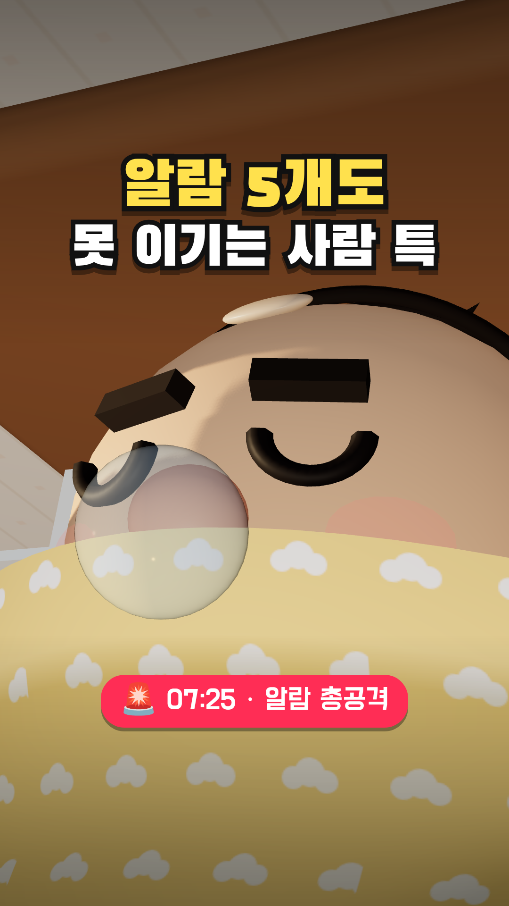

# 알람 5개도 못 이기는 사람 특 (릴스)



출근날인 줄 알고 알람 5개(폰 → 탁상시계 → 폰 → 거대 시계 → 수탉)를 전부 버티다 8시 57분에 일어나 정장 입고 토스트 물고 뛰쳐나갔는데… 알고 보니 **토요일**. 다시 꿀잠에 들자마자 주말 알람이 또 울리는 24초짜리 세로형 3D 코미디입니다. 「초고속 하산」의 그 아저씨가 잠옷 차림으로 다시 나옵니다.

- 결과물: [`renders/snooze-reel.mp4`](renders/snooze-reel.mp4) — 1080×1920, 30fps, 24초, H.264/AAC, 자막 번인
- 커버: [`renders/cover.png`](renders/cover.png) · 자막 파일: [`subtitles/snooze.ko.srt`](subtitles/snooze.ko.srt)

## 릴스용으로 고려한 점

| 항목 | 설정 | 이유 |
| --- | --- | --- |
| 비율 · 해상도 | 9:16, 1080×1920, 30fps | 릴스 권장 규격 |
| 길이 | **24초** | 끝까지 보는 비율이 높은 15~30초 구간. 짧은 개그가 빠르게 이어지는 구성 |
| 무한 반복 | 마지막 장면 = 첫 장면(알람 울리는 폰 + 같은 벨소리) | 끝나고 처음으로 자연스럽게 이어져 반복 재생 유도 |
| 첫 1초 | 큰 훅 문구 「알람 5개도 못 이기는 사람 특」 + 울리는 폰 클로즈업 | 스크롤을 멈추게 하는 장치 |
| 다시 보게 만드는 장치 | 첫 화면 폰 날짜·벽 달력에 이미 「토요일」이 적혀 있음 | 반전을 알고 다시 보면 보이는 복선 |
| 무음 시청 | 단어 단위 자막(노래방 스타일) + 예능 자막·의성어 | 소리 없이 봐도 다 이해되도록 |
| 안전 영역 | 글자는 가로 80~940px, 세로 200~1460px 안에 배치 | 상단 UI·하단 캡션/버튼·우측 아이콘에 가리지 않게 |
| 진행 표시 | 「⏰ 07:05 · 알람 2/5」 카운터 배지 | 반복되는 개그에 긴장감·진행감 부여 |
| 마무리 | 「알람 5개 맞추는 친구 태그 ㄱㄱ 👇」 | 댓글·태그 유도(CTA) |
| 커버 | 코풍선 장면 + 제목, 핵심 요소를 가운데 4:5 영역에 배치 | 프로필 그리드에 잘리지 않게 |

## 배경음악 (오리지널, 직접 합성)

150 BPM에 맞춰 1마디(1.6초)마다 컷이 바뀌도록 만들었습니다. 저작권 걱정이 없는 오리지널 곡입니다.

| 구간 | 음악 |
| --- | --- |
| 0.0 – 1.6초 | 오리지널 마림바 알람 벨소리 (훅) |
| 1.6 – 11.2초 | 나른한 그루브. 알람이 하나 늘 때마다 악기도 한 겹씩 추가 → 마지막 마디 스네어 롤 |
| 11.2 – 12.4초 | 정적 + 코풍선 부푸는 소리 → 「뽁!」 → 시계 초침 소리 |
| 12.35초 | 「8:57」 충격 효과음 |
| 12.8 – 16.0초 | 지각 질주 (빠른 드럼 + 사이렌) |
| 16.0초 | 레코드 스크래치 (토요일 발견) |
| 18.4 – 22.4초 | 주말 로파이 + 새소리 |
| 22.4 – 24.0초 | 다시 알람 벨소리 → 첫 장면으로 반복 |

통합 음량은 약 −13 LUFS(클리핑 없음)이고, 대사가 나올 때 음악 볼륨을 자동으로 낮춥니다. 인스타그램의 인기 음원을 쓰고 싶다면 업로드할 때 원본 오디오 볼륨을 낮추고 앱에서 음원을 추가하면 됩니다(효과음·대사는 원본에 남아 있음).

## 업로드용 캡션 예시

```
알람 5개 맞춰놓고 다 끈 사람 손 🙋‍♂️
(첫 장면 날짜 다시 보기 👀)

#직장인공감 #월요병 #알람 #지각 #주말 #3D애니메이션 #릴스 #공감
```

## 사용한 도구

Claude Code **Remotion 스킬/플러그인**, Remotion, Three.js + React Three Fiber(`@remotion/three`), `@remotion/captions`(TikTok 스타일 자막, .srt), `@remotion/media`, `@remotion/fonts`, 오픈소스 TTS **Supertonic 3**(대사), **faster-whisper**(여러 테이크 중 발음이 정확한 것을 자동 선택 + 단어 타이밍), numpy/scipy(효과음·음악 합성), Google Fonts(Black Han Sans · Jua · Do Hyeon, OFL). 캐릭터·방·소품은 모두 코드로 만들었고 외부 3D 모델은 쓰지 않았습니다.

## 실행

```bash
npm install
npm run dev       # Remotion Studio 미리보기 (SnoozeReel, Cover)
npm run render    # out/reel-master.mp4
npm run cover     # renders/cover.png
npm run srt       # subtitles/snooze.ko.srt

# (선택) 대사·음악 다시 만들기 — ../hiker-tumble/scripts/requirements.txt 와 동일한 파이썬 환경
python3 scripts/gen_voice.py            # 전체 대사
python3 scripts/gen_voice.py d4 d5      # 특정 대사만 다시 생성
python3 scripts/gen_audio.py            # 효과음 + 음악
```

`scripts/dialogue.json`이 대사의 단일 원본이며, 장면 타이밍은 `src/timeline.ts`(150 BPM 그리드)에 있습니다.
